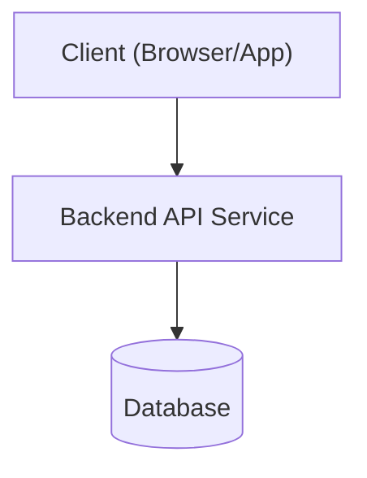

# アーキテクチャ設計スキル (Architecture & Design Skill)

このスキルは、仕様を満たす堅牢で保守性の高いシステムアーキテクチャおよびソースコード設計を策定するためのガイドラインを提供します。

---

## 設計項目と手順

### 1. 技術選定 (Tech Stack Selection)
- 言語 / フレームワーク (TypeScript/Node.js, Python/FastAPI, Go, Rust など)
- データベース (PostgreSQL, SQLite, Redis, BigQuery 等)
- サードパーティライブラリ / ORM / 依存関係の決定

### 2. システム構成 (System Topology)
- フロントエンド / バックエンド / データベースの接続構成
- 外部 API 連携および非同期処理 (キュー / ワーカー) の構成

### 3. ディレクトリ構造・モジュール分割
- プロジェクト階層の明確化 (レイヤードアーキテクチャ、クリーンアーキテクチャ、機能別モジュール分割など)
- 各ディレクトリ / ファイルの責務の定義

### 4. セキュリティ・認証・環境変数設計
- 認証方式 (JWT, OAuth2, Session)
- 秘密情報 (Secret Key, API Token) の環境変数管理 (.env / Secrets Manager)
- CORS / CSRF / Rate Limit 対策

---

## 設計書テンプレート (`docs/design.md`)

```markdown
# システム設計書: [プロジェクト名]

## 1. 技術スタック
- **Language**: 
- **Framework**: 
- **Database**: 
- **Tooling**: 

## 2. ディレクトリ構造案
```
src/
├── controllers/   # エンドポイントハンドラ
├── services/      # ビジネスロジック
├── models/        # データ構造・DBアクセス
├── utils/         # 共通ユーティリティ
└── index.ts       # アプリケーションエントリポイント
```

## 3. コンポーネント構成


## 4. セキュリティ・認証設計
- 環境変数によるコンフィグレーション分離
```
