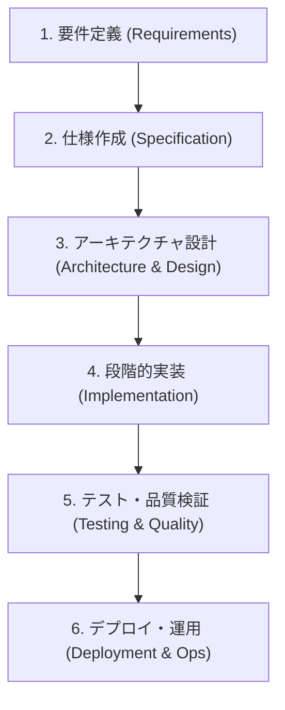

# 統合開発フロー (Full-Stack Development Workflow)

このスキルは、ユーザーの「作りたいもの」のインプットを受け取り、要件定義からデプロイまでの開発ライフサイクル全体を体系的かつ段階的にサポートするための統括ガイドです。

---

## 開発フローの全体像

---

## フェーズ別実行ガイド

### フェーズ 1: 要件定義 (Requirements Definition)
- **目的**: ユーザーの抽象的なアイデアや目的を具体的な機能要件・非機能要件に落とし込む。
- **参照スキル**: `requirements-definition`
- **主要な成果物**: 要件定義書 (`docs/requirements.md`)

### フェーズ 2: 仕様作成 (Specification Authoring)
- **目的**: 画面遷移、データモデル、API仕様、入出力フローを決定する。
- **参照スキル**: `specification-authoring`
- **主要な成果物**: 仕様書 (`docs/specifications.md`)

### フェーズ 3: アーキテクチャ設計 (Architecture & System Design)
- **目的**: 技術スタック、ディレクトリ構造、コンポーネント構成、セキュリティ方針を定義する。
- **参照スキル**: `architecture-design`
- **主要な成果物**: 基本設計・詳細設計書 (`docs/design.md`)

### フェーズ 4: 段階的実装 (Implementation)
- **目的**: 設計に基づき、型安全性とコーディング規約を遵守したコードを段階的に構築する。
- **参照スキル**: `implementation-guide`
- **主要な成果物**: アプリケーションコード (`src/` 等)

### フェーズ 5: テスト・品質検証 (Testing & Quality Assurance)
- **目的**: 単体テスト、結合テスト、静的解析を実行し、動作と品質を保証する。
- **参照スキル**: `testing-quality`
- **主要な成果物**: テストコード、品質チェック結果

### フェーズ 6: デプロイ・運用 (Deployment & Operations)
- **目的**: コンテナ化、CI/CDパイプライン設定、本番/検証環境へのデプロイを行う。
- **参照スキル**: `deployment-ops`
- **主要な成果物**: `Dockerfile`, `docker-compose.yml`, CI/CD ワークフロー設定

---

## 運用上の原則

1. **フェーズの不可逆的進行を避ける**:
   前のフェーズの成果物が曖昧なまま次へ進まず、疑問点がある場合は確認・合意を行ってから次のフェーズへ進む。
2. **成果物のドキュメント化**:
   各フェーズで作成された仕様・設計・結果は `docs/` ディレクトリに明示的に保存し、いつでも参照可能にする。
3. **検証の自動化**:
   実装・テスト・デプロイフェーズでは、必ず実行コマンドを用いて動作確認・検証を行う。
