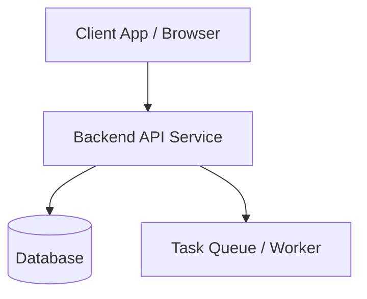

# アーキテクチャ・設計書 (Architecture & System Design)

## 1. 技術スタック・選定基準

- **フロントエンド / UI**:
- **バックエンド / API**:
- **データベース / ストレージ**:
- **インフラ・実行環境**:

---

## 2. システム構成・トポロジー



---

## 3. ディレクトリ・モジュール構造

```
src/
├── controllers/   # ルーティングおよびハンドラ
├── services/      # ビジネスロジック層
├── models/        # データアクセスメソッド・スキーマ定義
├── utils/         # 共通ヘルパー・ロガー
└── index.ts       # アプリケーションエントリポイント
```

---

## 4. セキュリティ・認証・環境変数設計
- **認証**: JWT / OAuth2 
- **環境変数**:
  - `PORT`: サーバーポート
  - `DATABASE_URL`: 接続用接続文字列
  - `SECRET_KEY`: セッション/トークン署名用鍵
