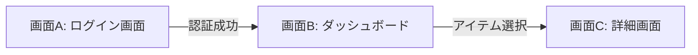

# システム仕様書 (System Specifications)

## 1. データモデル / エンティティ仕様

### [EntityName]
| フィールド名 | 型 | 必須 | 説明 | 備考 |
| :--- | :--- | :--- | :--- | :--- |
| `id` | String/UUID | Yes | 一意の識別子 | 主キー |
| `created_at` | DateTime | Yes | 作成日時 | 自動割り当て |

---

## 2. API / インターフェース仕様

### `POST /api/v1/resource`
- **概要**: リソースの新規作成
- **リクエストヘッダー**:
  - `Content-Type: application/json`
  - `Authorization: Bearer <token>`
- **リクエストボディ**:
```json
{
  "name": "example",
  "type": "standard"
}
```
- **レスポンス (201 Created)**:
```json
{
  "id": "12345",
  "name": "example",
  "status": "created"
}
```
- **エラーレスポンス**:
  - `400 Bad Request`: 入力バリデーション違反
  - `401 Unauthorized`: 認証エラー

---

## 3. UI / 画面遷移仕様



---

## 4. ビジネスロジック・状態遷移・例外処理
- **状態遷移図**: `未処理` -> `処理中` -> `完了` / `エラー`
- **バリデーションルール**: メールアドレス形式チェック、パスワード8文字以上など
